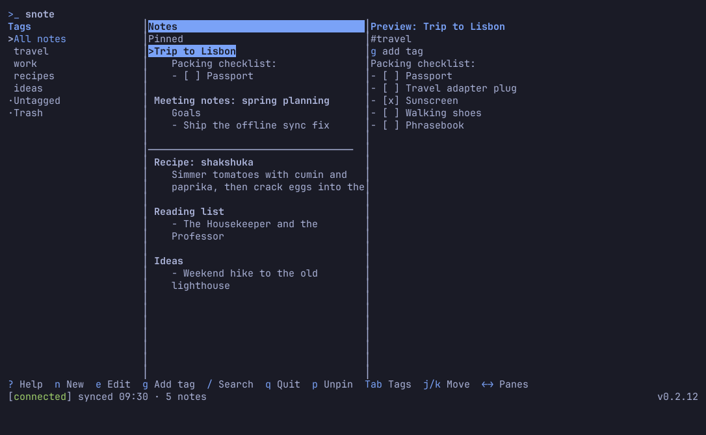
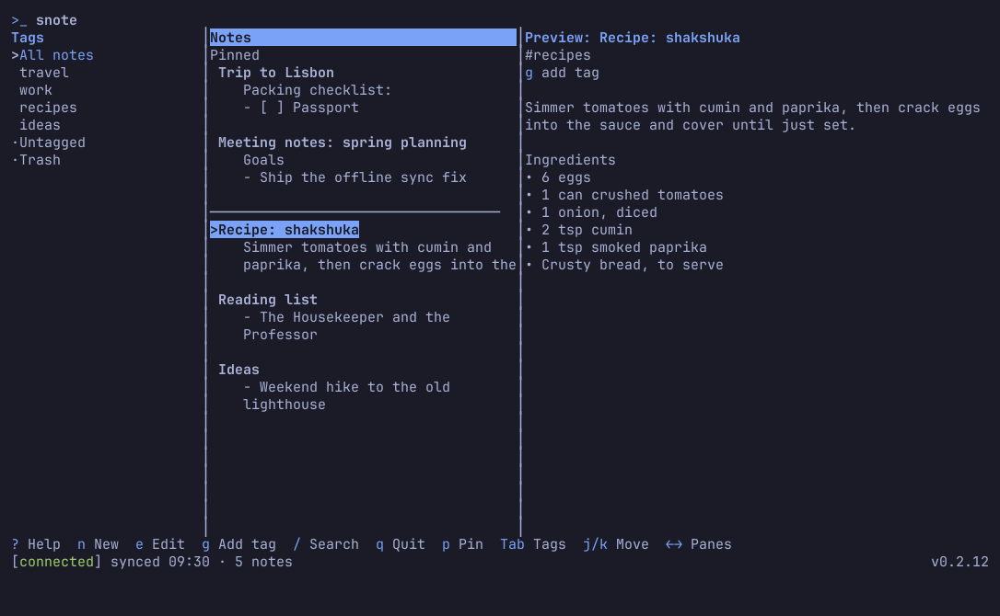
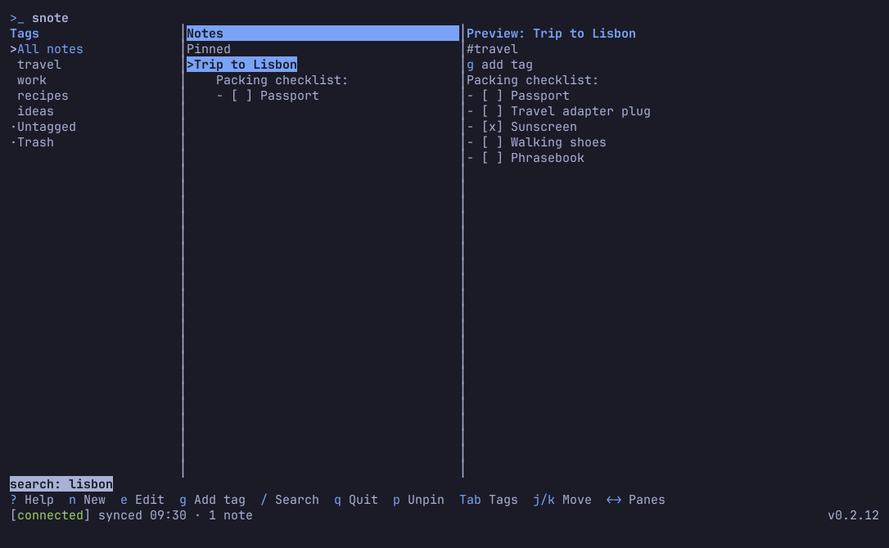
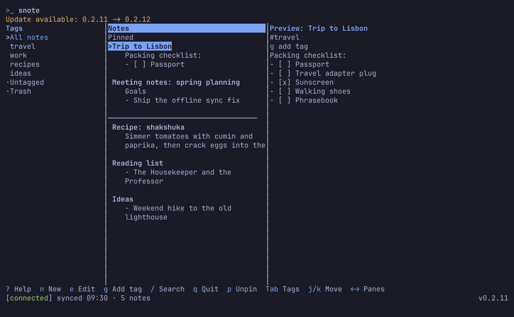
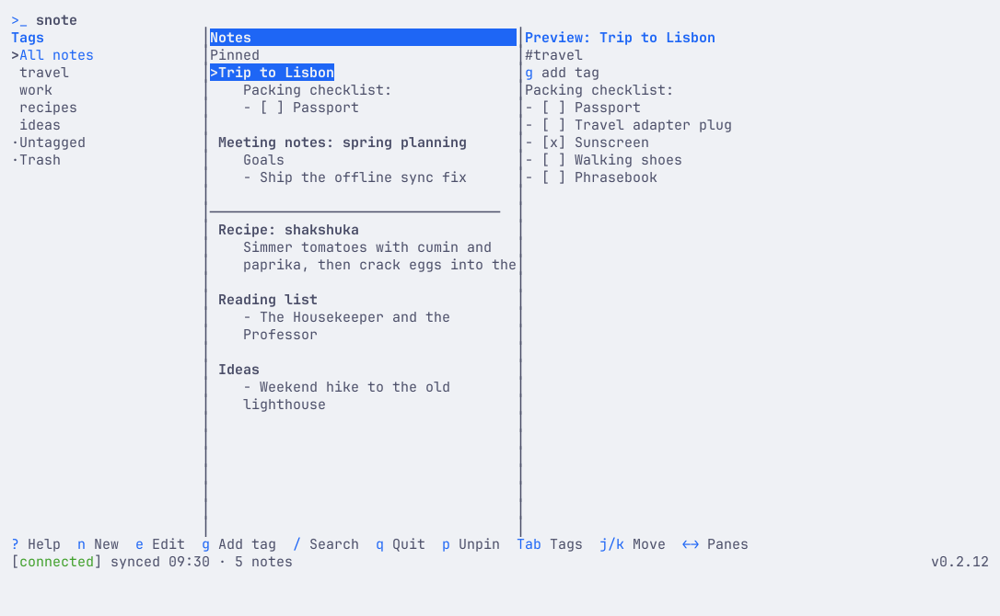

# snote — Simplenote for Omarchy

A keyboard-driven terminal client for Simplenote that reuses the official open-source sync engine
(`simperium` + the Redux sync layer from `simplenote-electron`) and adds an Omarchy-native TUI.
GPL-2.0-only.

snote is an unofficial, community-built Simplenote client. It is not affiliated with, endorsed by, or supported by Automattic. If snote is useful to you, a star on GitHub helps other people find it.


## Screenshots

 Notes, open note and header bar in one view<br>
 Markdown preview<br>
 Search<br>
 Update banner when a newer version is out<br>
 Light theme<br>

## What it is

snote is a fast, keyboard-first Simplenote client for the terminal, built for Omarchy. It uses the
same Simperium sync protocol as the official apps, so notes, tags, and pins stay in sync. It draws
with your terminal's own 16 ANSI colours, so it looks native in any theme, dark or light.

## Why

Simplenote's official apps are Electron, GTK, or web, none built for the terminal. snote gives you
the whole note loop (browse, search, edit, tag, publish) without leaving it or shipping a browser.

## How it works

1. **Install** it as a pacman package built from this repo, or from source (below).
2. **Launch** it from the Omarchy app menu, a Hyprland keybinding, or `snote` on the command line.
3. **Log in** with your Simplenote account — email code or password.
4. **Use the keys** in the table below; press `?` any time for the in-app reference.

## Install on Omarchy

Requires Node.js 22 or newer. The first click uses the Node.js that a standard Omarchy already has, through mise. Setup installs nothing but snote itself.

A one-click bar button is available through the Omarchy plugin marketplace:

```
omarchy plugin add https://github.com/donnishcomau/snote --enable
```

The first click copies the pre-built snote from this plugin's own clone (no build step) and adds a `~/.local/bin/snote` shim; later clicks launch or focus it. Remove it with:

```
~/.config/omarchy/plugins/io.github.donnishcomau.snote-simplenote/packaging/omarchy/uninstall
omarchy plugin remove io.github.donnishcomau.snote-simplenote
```

A pacman package recipe lives at `packaging/aur/PKGBUILD`, and building from a source checkout (`npm ci`, then `npm run build`, then `sh packaging/omarchy/install.sh` for the desktop launcher) is documented in `docs/INSTALL.md`.

Without the plugin, download the installer to a file and run it: `curl -fL -o snote-install https://github.com/donnishcomau/snote/releases/latest/download/snote-install`, then `bash snote-install`. This installer is for Linux only; on a Mac, use "Install on macOS (Homebrew)" below. It writes only `~/.local/share/snote-app` and the `~/.local/bin/snote` shim, needs no administrator rights and never touches your notes in `~/.local/share/snote`; to remove it, delete those two. It refuses to run while the plugin's snote is installed. It checks the download against the release's checksum list only, not its signature, so a first install trusts the release it gets (trust on first use; see `SECURITY.md`).

Run `snote --check` to print the editor, data dir, terminal size and whether `wl-copy` and `omarchy-launch-tui` were found. snote draws only the 16 ANSI colours of your terminal theme.

Bind a hotkey in `~/.config/hypr/bindings.lua`:
```
o.bind("SUPER + SHIFT + N", "Simplenote", "omarchy-launch-tui --app-id=TUI.float snote")
```

## Install on other Linux (Homebrew)

On Ubuntu, Fedora and other Linux distributions, install snote with Homebrew. If Homebrew is not installed yet, install it first from https://brew.sh, then run `brew install donnishcomau/snote/snote`. Homebrew installs Node.js for snote, so you do not install it yourself. Your notes are kept in `~/.local/share/snote` (under `XDG_DATA_HOME` if set), the same folder as on Omarchy, and `brew uninstall snote` leaves that folder. The Omarchy bar button comes only with the marketplace plugin above.

## Install on macOS (Homebrew)

On a Mac with Apple silicon, install snote with Homebrew and run it in Terminal. If Homebrew is not installed yet, install it first from https://brew.sh, then run `brew install donnishcomau/snote/snote`. Homebrew installs Node.js and `flock` for snote, so you do not install them yourself. Your notes are kept in `~/.local/share/snote` (under `XDG_DATA_HOME` if set), not under `~/Library`, and `brew uninstall snote` leaves that folder. There is no bar button on macOS, and copying a note's link uses `pbcopy`. Run `snote --check` to see whether `/usr/bin/pbcopy` was found.

## Updating

A Homebrew install updates only with `brew upgrade snote`: it does not check for updates itself and does not offer the in-app update. To update snote, run `omarchy plugin update io.github.donnishcomau.snote-simplenote`; press `q` to leave the diff pager (or pass `--yes` to skip the diff); then click the bar button once, run `omarchy-restart-shell` (the bar keeps the old widget until it restarts), and restart any open snote windows. The update installs the latest public commit, and the public repo only receives reviewed, released commits. Or, when snote shows an update banner, press `U` and answer `y`: snote quits and opens the same update as the bar's update button in a floating terminal, which asks `Update snote now? [y/N]` before it fetches anything. On a direct install (`snote-install`), `U` and `y` work differently: snote saves your changes, downloads the newer release from github.com, checks it with the keys it already has and hands it to its update helper, which installs it once snote has quit and keeps the old build if a check fails. After a successful update, the next time you start snote, it runs the new version. If you installed 0.2.10 or older, reinstall once for 0.2.11, because the public history was rewritten and `omarchy plugin update` cannot apply it: run `omarchy plugin remove io.github.donnishcomau.snote-simplenote`, then `omarchy plugin add https://github.com/donnishcomau/snote --enable`, then click the bar button once and run `omarchy-restart-shell` (your notes, signed-in account and unsent changes are kept; the steps are in `docs/release-notes-0.2.11.md`).

## Pre-built plugin files

`plugin-dist/` is generated by `npm run build:plugin` from the source in this repo. CI regenerates `plugin-dist/` and compares it on every push. Verify locally with `node scripts/build-plugin-dist.mjs --check plugin-dist`. One chunk holds the yoga layout engine as a base64 WebAssembly string.

## First run and login

When you first start snote you enter your email address and press Enter; a login code is emailed to you. Type the code and press Enter to complete login. If you prefer password login, press `Tab` while on the email screen to switch to the password step.

## Launcher

Once installed, you can launch snote from the Omarchy app menu. Open the menu, navigate to `Install > TUI`, and select the snote entry — this invokes `<omarchy>/bin/omarchy-tui-install` to create a desktop launcher.

Alternatively, a Hyprland binding is available. The configuration includes `{ tui = "snote", focus = true }`, which runs `omarchy-launch-or-focus-tui snote` to launch or focus the app.

Middle-click the bar button to open a new note (`snote --new`). If snote is already running, the request is sent with `snote --notify-new` and its window is focused.

## Editor

Press `e` to edit a note. By default this edits in place, in the same window, using your Omarchy default editor — falling back to `nvim` if none is set — and returns to snote as soon as you save and quit (`:wq` in nvim).

Omawrite, Omarchy's markdown editor, is supported as an option rather than the default: set it as your Omarchy default editor, or set `SNOTE_EDITOR=omawrite`. Because Omawrite opens in its own window, snote waits and shows "Editing in Omawrite — save with Ctrl+S and close its window to return".

Editor selection priority: `SNOTE_EDITOR`, then the Omarchy default-editor setting, then `nvim`, then
`EDITOR`, then `omawrite`. GUI editors must wait for you to close the file: set `SNOTE_EDITOR` to `code --wait`, `codium --wait`, `subl -w` or `gvim -f`. New-note editor: `SNOTE_NEW_NOTE_EDITOR` is `external` (default) or `inline`; any other value means `external`. Inline creates no note until you type, and autosaves about 1.5 s after your last key. To turn it on, set the variable where snote starts. When you type `snote` in a terminal, add `export SNOTE_NEW_NOTE_EDITOR=inline` to `~/.bashrc`, below the line that says to add your own exports. When you start snote from the bar button, the app menu or a key binding, it takes the desktop session's settings: add `hl.env("SNOTE_NEW_NOTE_EDITOR", "inline")` to `~/.config/hypr/hyprland.lua` (on an older Omarchy with `~/.config/hypr/hyprland.conf`, add `env = SNOTE_NEW_NOTE_EDITOR,inline` there), then log out and back in. A new note from the bar's middle-click opens in the snote that is already running, if there is one, so that snote's setting applies.

Press `i` to edit inline in the preview pane instead: it saves as you type, Enter adds a new line and
`Esc` closes and keeps your text; `h` restores an older version. `e` still opens your editor as before. Only the inline editor autosaves as you type; an external editor such as nvim saves and syncs each time you write the file (:w) and again when you quit (:wq). In nvim, the line at the top shows `:w save & sync` and the time of the last save, and the first `:w` of a new note creates it while nvim stays open. Press `n` for a new note: it opens your editor like `e`, or the inline editor if you set `SNOTE_NEW_NOTE_EDITOR=inline`.

## Screen-reader mode

Start snote with `snote --screen-reader`, or set `SNOTE_SCREEN_READER=1` (`--no-screen-reader` wins over it). The screen is then one linear column, no colour, and Help and the editor hand-off work in it, as do search, tags and history. Ink's own `INK_SCREEN_READER` is ignored.

## Keys

| Key | Action |
| --- | --- |
| `j` | Move down |
| `k` | Move up |
| `Enter` | Open note |
| `Tab` | Next pane (with the tags pane open: tags and notes) |
| `←` / `→` | Move between the tags, notes and preview panes |
| `q` | Quit |
| `v` | Toggle rendered markdown preview |
| `?` | Show this help |
| `Escape` | Close overlay / back |
| `e` | Edit in $EDITOR |
| `i` | Edit inline (built-in editor) |
| `n` | New note |
| `g` | Edit tags of the selected note |
| `w` | Export note to .md |
| `b` | Send to blog as draft |
| `L` | Log out (asks first) |
| `d` | Move to trash |
| `u` | Restore from trash (trash view) |
| `D` | Delete forever (trash view) |
| `T` | Show trash / all notes |
| `E` | Empty the trash (trash view) |
| `p` | Pin / unpin |
| `m` | Markdown on / off |
| `s` | Sort: modified, created, a-z |
| `S` | Reverse the sort order |
| `/` | Search notes |
| `t` | Show / focus the tags pane |
| `J` | Move tag down (tags pane) |
| `K` | Move tag up (tags pane) |
| `R` | Rename tag (tags pane) |
| `x` | Delete tag (tags pane) |
| `r` | Sync now |
| `P` | Publish / unpublish |
| `y` | Copy the public link |
| `h` | Note history (Enter restores) |
| `c` | Tick / untick item (note) |
| `a` | Add checklist item (note) |

Press ? in the app for the current list.

## Reporting a bug

If you find a bug, run `snote --report` to generate a diagnostic file (`report-*.json`) and attach it to your issue. See `CONTRIBUTING.md` for details on writing good issues and how to submit pull requests.

## Credit and licence

snote vendors source code from Automattic's `simplenote-electron` client, copyright Automattic, Inc., and is licensed under the GNU General Public License, version 2 (GPLv2).
See the `NOTICE` file for full attribution details and the `LICENSE` file for the full licence text.

## Develop
```
npm ci
make check            # the only definition of done
npm run dev           # run from source
```

See `AGENTS.md` for the architecture, vendoring rules, and test conventions, and `CONTRIBUTING.md` for how to open an issue or a pull request.

## Sync and data

snote syncs through Simperium, the same sync service the official Simplenote apps use, so notes, tags, and pins stay in sync across your devices. Login is by email code or password (see First run and login). Notes live only in Simplenote's cloud and your local cache. At start-up, and every 24 hours while it stays open, snote runs `git ls-remote` against the plugin's https origin to look for a release; `SNOTE_UPDATE_CHECK=off` turns it off. The bar update click fetches a release tag from github.com over https. If the plugin folder's origin is a local folder path instead, the bar update click fetches from that folder; the start-up check ignores such an origin. On the plugin, pressing `U` in snote and answering `y` opens the same update as the bar update click. A direct install (`snote-install`) has no plugin origin. Instead, at start-up (unless a saved answer is under 24 hours old) and every 24 hours while it stays open, it downloads the release list `ASSETS.SHA256SUMS` and its signature from github.com over https. After `U` and `y` it downloads the newer release from there too. It uses a download only when the list's signature verifies with the keys it already has and the release matches the list. `SNOTE_UPDATE_CHECK=off` turns that check off too, and with it the banner and `U`. From 0.2.9, each release's checksum list (`SHA256SUMS`) is signed by the maintainer; from 0.2.12, before the plugin folder moves to a fetched release, the installed snote checks that signature with its own keys and every other file against the list, and refuses the update if a check fails; setup then checks the files it installs against the list. A snote older than 0.2.12 has no such check, so its update to 0.2.12 is not verified. A first install trusts the keys it installs (trust on first use; see `SECURITY.md`). Your blog origin (`skryf.art` unless you set `SNOTE_BLOG_ORIGIN` before the first send) is contacted only when you press `b`, sending the note's title, markdown and your blog token. See `SECURITY.md` for the full list.
Published notes are readable by anyone who holds the https link.

## Known issues

- If snote is killed (not quit) within about 150 ms of saving with `:w` while the editor is open, the note can appear twice at the next start. Both copies keep your text; nothing is lost. A normal quit is not affected.
- An editor that passes the file to a window that is already open is not watched for `:w`, and snote saves nothing from it. Set `SNOTE_EDITOR` to a command that waits: `code --wait`, `codium --wait`, `subl -w` or `gvim -f`.
- Rare restart cases can still double or lose a change. After a restart that downloads every note again, an edit can appear twice: the text is doubled, not lost. In rare timing cases, an edit made around a restart can be lost. In an unusual case, an untouched line can still be dropped when another device moved a line that you deleted offline. After a restart, check recent edits in History (`h`).
- With no kernel lock (macOS without Homebrew's `flock`, a Linux without util-linux, or a data folder on a network drive), two copies of snote started at the same moment can both run. Run one snote at a time on a data folder.
- Two devices adding text to one note within about a second once produced a garbled note on the real service. It has not been seen again.
- Each release's known issues, and what it fixed, are listed in `CHANGELOG.md`.

## Known limitations and ideas for improvement

- Startup is above the 150 ms target with 10,000 notes; a performance pass (bench: `scripts/bench.mjs`) may bring it down.
- No bulk export; `w` exports one note at a time to a `.md` file. You choose the folder and the file name; a name cannot be only an extension such as `.md`, and an existing file is never overwritten.
- ZWJ emoji sequences (multi-codepoint emoji) may misalign; the terminal sanitizer strips variation selectors but not ZWJ.
- No image attachments.

## Security

Please report security issues as described in `SECURITY.md`; never post credentials in a public issue.

## Keeping up with upstream Simplenote
`scripts/vendor.sh --diff` shows upstream changes to the vendored files since the pinned commit.
Port them, bump `UPSTREAM_COMMIT`, run `make check`.
